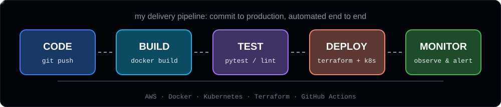

<!-- ===================== HEADER BANNER ===================== -->
<div align="center">


<a href="https://git.io/typing-svg">
  
</a>

<br><br>

<a href="https://www.linkedin.com/in/mehak-tewari-04934b247"></a>
<a href="https://leetcode.com/u/mehaktewari07/"></a>
<a href="https://www.instagram.com/_mehak_._tewari_/"></a>
<a href="mailto:tewarimehak2107@gmail.com"></a>


<br><br>



</div>

<br>

## 👩‍💻 About Me

I'm a **DevOps Engineer at Clouds Analytics**, focused on building **reliable, scalable, and automated cloud-native systems**.

My journey started with software development and evolved into **Cloud, DevOps, automation, and AI-powered engineering workflows**, giving me a strong understanding of both the applications and the infrastructure needed to build, deploy, and operate them.

I love systems that are not just functional, but also **automated, maintainable, observable, secure, and scalable**, and I'm especially curious about how **DevOps and AI can work together** to change how software is built, deployed, monitored, and operated.

<br>

| | |
|---|---|
| 🔭 **Currently working on** | CI/CD pipelines, cloud automation & containerized deployments |
| 🌱 **Currently exploring** | Kubernetes, Terraform & AI-powered engineering workflows |
| 🎓 **Education** | B.Tech CSE, SRM Institute of Science and Technology (CGPA 8.93) |
| 📍 **Based in** | New Delhi, India |
| 😄 **Pronouns** | She/Her |
| ⚡ **In one line** | An engineer who loves turning manual work into automated, scalable systems |

<br>

## 🎯 Core Areas

<div align="center">

| ☁️ Cloud & DevOps | 🔁 Automation | 🤖 AI & Backend |
|:---:|:---:|:---:|
| AWS, Docker & Containers | CI/CD & Deployment Automation | AI-Powered Engineering Workflows |
| Infrastructure as Code (Terraform) | Python Scripting & REST Integrations | Python & Backend Development |
| Secure, Observable & Scalable Systems | Monitoring & Troubleshooting | Full-Stack Web Applications |

</div>

<br>

## ⚙️ How I Ship

<div align="center">
  
</div>

<br>

## 🛠️ Tech Stack

<div align="center">

**☁️ Cloud & DevOps**<br>


**💻 Languages**<br>


**🌐 Frameworks & Libraries**<br>


**🗄️ Databases & Data**<br>


**🚀 Deployment & Tools**<br>


</div>

<br>

## 🚀 Featured Projects

<table>
  <tr>
    <td width="50%" valign="top">
      <h3>🏥 <a href="https://github.com/mehaktewari/MEDIASSIST-AI">MediAssist AI</a></h3>
      AI healthcare document assistant with <b>RAG-based Q&A</b>, drug interaction checking, health risk scoring, and multi-user auth.<br><br>
          
    </td>
    <td width="50%" valign="top">
      <h3>🔐 <a href="https://github.com/mehaktewari/Secure-Blog-Platform">Secure Blog Platform</a></h3>
      Production-ready full-stack blog with <b>JWT auth, rate limiting, and background jobs</b>, deployed on Vercel & Render.<br><br>
         
    </td>
  </tr>
  <tr>
    <td width="50%" valign="top">
      <h3>🌌 <a href="https://github.com/mehaktewari/virtual-cosmos">Virtual Cosmos</a></h3>
      Real-time <b>2D proximity-based chat app</b> where users interact dynamically based on distance.<br><br>
         
    </td>
    <td width="50%" valign="top">
      <h3>🏦 <a href="https://github.com/mehaktewari/AI-BANKIING-Chatbot">AI Banking Chatbot</a></h3>
      Intelligent banking support system combining <b>NLP, LLMs, and backend automation</b>.<br><br>
       
    </td>
  </tr>
  <tr>
    <td width="50%" valign="top">
      <h3>💬 <a href="https://github.com/mehaktewari/VIFY">Vify</a></h3>
      Language exchange platform with <b>friend requests and private chats</b> to practice languages in real time.<br><br>
       
    </td>
    <td width="50%" valign="top">
      <h3>✅ <a href="https://github.com/mehaktewari/TASKFORM-">TaskFlow</a></h3>
      Full-stack task manager with <b>auth, priorities, due dates</b>, and completion tracking.<br><br>
         
    </td>
  </tr>
</table>

<details>
<summary><b>📂 More projects</b></summary>
<br>

| Project | Description | Tech |
|---|---|---|
| [Pokedex tRPC App](https://github.com/mehaktewari/pokedex-trpc-app) | Full-stack Pokedex application | Next.js, Prisma, tRPC |
| [Mars Rover Assignment](https://github.com/mehaktewari/mars-rover-assignment) | Navigation simulation on a plateau grid | Python |
| [Customer Churn Analysis](https://github.com/mehaktewari/CUSTOMER-CHURN-AND-RETENTION-DECISION-ANALYSIS) | Churn drivers, KPIs, pivot tables & dashboard | Excel, Jupyter |
| [Bookmark Blog](https://github.com/mehaktewari/BOOKMARK-Blog) | Blogging platform with core PHP and MySQL | PHP, MySQL, CSS |
| [Support Ticket System](https://github.com/mehaktewari/SUPPORT-TICKET-SYSTEM) | Ticket management system | Python |

</details>

<br>

## 💼 Experience

```text
2026 ─ Present   ☁️  DevOps Engineer          · Clouds Analytics
                     CI/CD workflows, deployment automation, containerized & cloud-native apps

2026 (Mar-Jun)   🐍  Python Developer Intern  · Janus Koncepts
                     REST API integrations, automation pipelines, retries & error handling

2025 (Nov-Jan)   🐍  Python Developer Intern  · The Developers Arena
                     8 Python projects per week: data processing, scripting, backend logic

2025 (Jun-Oct)   🚇  Software Developer Intern · Delhi Metro Rail Corporation (NIC)
                     Full-stack web apps with PHP, MySQL, HTML, CSS, JavaScript

2024 (Jun-Jul)   🌐  Web Developer Intern     · CodSoft
                     React.js and HTML5 web development
```

<br>

## 📜 Certifications

<div align="center">


<br>


<br>


</div>

<br>

## 📊 GitHub Stats

<div align="center">


<br><br>

<picture>
  <source media="(prefers-color-scheme: dark)" srcset="https://raw.githubusercontent.com/mehaktewari/mehaktewari/output/github-snake-dark.svg">
  
</picture>

</div>

<br>

## 🤝 Let's Connect

<div align="center">

💬 Always open to connecting with **engineers, builders, recruiters, and professionals** in **DevOps, Cloud, AI, and Software Engineering**.

I share practical insights from real-world projects on LinkedIn: cloud & DevOps work, debugging, automation, AI tools, and my journey as an engineer.

<a href="https://www.linkedin.com/in/mehak-tewari-04934b247"></a>
<a href="mailto:tewarimehak2107@gmail.com"></a>

<br>

*"Automate everything you can. Understand everything you automate."* 🚀


</div>